# AWS IoT LoRaWAN ingestion in a multi-tenant SaaS

> **Portfolio excerpt from ManageMyFarm.** This code comes from a larger private farm-management product that was built as a working system and hosted on AWS. This repository presents one focused backend path for review; it is not a standalone application.

## Project context

ManageMyFarm connects farm sensors to a multi-tenant SaaS platform. The deployed system uses AWS IoT Core for LoRaWAN ingestion, a FastAPI backend, and PostgreSQL with a separate database for each tenant. The wider product also includes authentication, device management, alerting, dashboards, and farm operations workflows.

This excerpt focuses on how an AWS uplink becomes tenant-scoped telemetry. The full product and its deployment configuration remain private.

## Data path

```mermaid
flowchart LR
    S[LoRaWAN sensor] --> G[Farm gateway]
    G --> A[AWS IoT Core for LoRaWAN]
    A --> M[MQTT over mTLS]
    M --> P[AWS IoT provider]
    P --> U[Provider-neutral uplink]
    U --> R[Resolve tenant by gateway EUI]
    R --> T[That tenant's PostgreSQL database]
    T --> D[Typed telemetry metrics]
    D --> X[Alerts and dashboard]
```

## Engineering details

- **Provider boundary:** the AWS provider handles AWS Wireless MQTT events and maps device, gateway, signal, port, timestamp, and payload fields into the shared `UplinkData` contract.
- **Tenant isolation:** the backend looks up the gateway EUI in the platform database and selects that tenant's database. The uplink handler drops packets if the gateway is not registered; it does not route packets from unknown gateways to a default tenant.
- **Telemetry model:** sensor data is flattened into metric/value rows. Numeric, string, and boolean values use separate fields, while transport metadata is filtered out of the metric set.
- **Operational metadata:** the uplink retains gateway and radio details such as RSSI, SNR, and FPort for downstream processing.

## Code tour

| Review order | File | What to inspect |
|---|---|---|
| 1 | `excerpts/app/iot_providers/aws_iot_provider.py` | `_connect_mqtt` and `_on_message_received`: AWS subscription and uplink normalization |
| 2 | `excerpts/app/iot_providers/uplink_contract.py` | `UplinkData`: the boundary between the IoT provider and application handler |
| 3 | `excerpts/app/tenant_routing_excerpt.py` | `get_tenant_by_gateway_eui`: case-insensitive gateway lookup and tenant selection |
| 4 | `excerpts/app/services/telemetry_service.py` | `extract_metrics_from_sensor_data` and `insert_telemetry`: metric filtering and typed persistence |
| 5 | `excerpts/app/services/water_tank_alert_excerpt.py` | `detect_tank_drop`: time-series comparison, policy threshold, and irrigation suppression |

For a support-focused example of tracing a missing or unexpected reading through this system, see [`SUPPORT_WALKTHROUGH.md`](SUPPORT_WALKTHROUGH.md).

The excerpts are taken from these production files in the private backend:

- `cloud/backend/app/iot_providers/aws_iot_provider.py`
- `cloud/backend/app/iot_providers/base.py`
- `cloud/backend/app/lorawan_handler.py`
- `cloud/backend/app/services/telemetry_service.py`
- `cloud/backend/app/services/water_leak_detector.py`
- `cloud/backend/app/services/alert_policy.py`
- `cloud/backend/app/tenant_models.py`

## Scope

This is a curated source extract, not a runnable demo. The included code relies on the larger backend for configuration, AWS gateway and device managers, SQLAlchemy models, database sessions, payload decoding, and the rest of the uplink handler. No AWS credentials, certificates, customer records, or production environment files are included.

The selected application logic is preserved while unrelated production code is omitted; whitespace was cleaned up for this portfolio copy. The original product repository and its Git history are not included. The water alert excerpt is for farm water-tank monitoring, not fuel systems.
