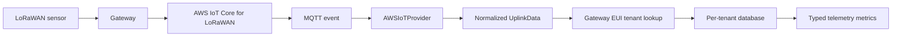

# AWS IoT to tenant telemetry — portfolio excerpt

This repository is a small, curated code excerpt from **ManageMyFarm**, a larger private farm-management SaaS that was built as a working system and hosted on AWS with AWS IoT Core for LoRaWAN ingestion.

It highlights one end-to-end engineering concern: receiving device uplinks, identifying the farm that owns the gateway, and storing sensor metrics in that tenant's database. The production application also includes authentication, device management, alerting, dashboards, and other farm workflows; those remain in the private product repository.

## Data path

## What this code demonstrates

- **Provider boundary:** the AWS implementation turns AWS Wireless MQTT messages into the provider-neutral `UplinkData` contract used by the shared provider interface.
- **Tenant isolation:** an uplink is routed by its gateway EUI to the registered tenant database. The live handler drops packets when the gateway is not registered.
- **Telemetry modeling:** incoming sensor values are flattened, metadata fields are filtered out, and each metric is stored in a typed column for numeric, string, or boolean values.

## Excerpts

| File | Production source | What to look at |
|---|---|---|
| `excerpts/app/iot_providers/aws_iot_provider.py` | `cloud/backend/app/iot_providers/aws_iot_provider.py` | AWS MQTT subscription, AWS Wireless payload normalization, and provider operations |
| `excerpts/app/iot_providers/uplink_contract.py` | `cloud/backend/app/iot_providers/base.py` | Shared uplink data contract |
| `excerpts/app/tenant_routing_excerpt.py` | `cloud/backend/app/lorawan_handler.py` | Gateway EUI lookup against the platform database |
| `excerpts/app/services/telemetry_service.py` | `cloud/backend/app/services/telemetry_service.py` | Metric flattening and typed telemetry insertion |

## Context and limits

These are source excerpts, not a standalone application. They rely on the surrounding private backend for configuration, AWS manager classes, SQLAlchemy models, database sessions, and the rest of the uplink handler. They are provided to show a small part of a larger working system; they are not a runnable AWS demo.

No AWS credentials, certificates, customer records, or production environment files are included. The original product repository and its deployment history are not included here.
